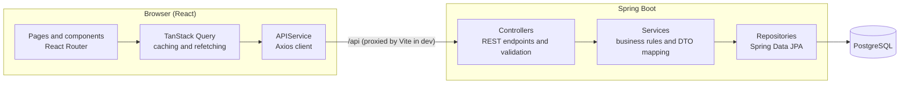
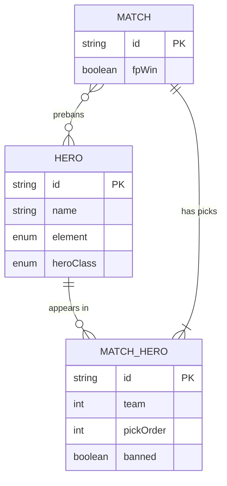

# RTAStats

A full-stack statistics application for **Epic Seven**'s ranked draft mode (RTA). Log your matches, then explore which heroes actually win: win rates, pick and ban behaviour, and (soon) how those numbers change between your own games and the wider player base.

> **Status:** work in progress. The core data pipeline (enter matches, store them, rank heroes) and an admin area are working. Authentication and personal-versus-global analysis are next. See the [Roadmap](#roadmap).


## Table of contents

- [Why this project exists](#why-this-project-exists)
- [Features](#features)
- [Tech stack](#tech-stack)
- [Architecture](#architecture)
- [How the stats are calculated](#how-the-stats-are-calculated)
- [Getting started](#getting-started)
- [API overview](#api-overview)
- [Project structure](#project-structure)
- [Design decisions](#design-decisions)
- [Known limitations](#known-limitations)
- [Roadmap](#roadmap)
- [Disclaimer](#disclaimer)

## Why this project exists

Epic Seven's RTA is a draft game: both players pick five heroes, with bans before and after the draft. Which heroes are strong depends heavily on how the draft plays out, and the game itself offers little in the way of aggregate statistics.

RTAStats is a way to record matches and turn them into insight. It is also a deliberately end-to-end engineering project: a relational data model, a layered REST API, a React front end, and the unglamorous work in between (validation, data correction, keeping the two halves consistent).

## Features

**Working today**

- **Hero rankings:** a homepage table of the top 20 heroes by win rate, with match counts and each row coloured by the hero's element.
- **Match entry:** a form for logging a match with first-pick selection, ten hero slots (searchable, only existing heroes accepted), one postban per side, and optional prebans. Input is validated before it is sent.
- **Admin area:**
  - Add, edit and delete heroes.
  - Browse all matches, edit them using the same form as entry, or delete them.
  - Matches that break the draft rules (for example a team with four picks) are flagged so corrupted data is easy to find and fix.
- **Persistent storage** in PostgreSQL.

**Planned:** user accounts, personal versus global win rates, and deeper analysis. See the [Roadmap](#roadmap).

## Tech stack

| Layer | Technology |
|---|---|
| Front end | React (Vite), React Router, TanStack Query, Axios |
| Back end | Java 21, Spring Boot 4, Spring Data JPA (Hibernate), Lombok, Maven |
| Database | PostgreSQL (run via Docker) |
| Tooling | Docker, Vite dev proxy |

## Architecture



**Back end.** A conventional layered design. Controllers handle HTTP and validation, services hold the business logic and translate between entities and DTOs, and repositories talk to the database. Entities never leave the service layer: requests arrive as DTOs containing hero IDs, and responses are flat DTOs.

**Front end.** All HTTP calls live in one service file (`APIService.js`). Components never build URLs or handle Axios details. TanStack Query sits on top, giving caching, loading and error state, and automatic refetching after changes (for example, submitting a match refreshes the rankings).

**Data model.**



A match has ten `MATCH_HERO` rows (five per team). Team 1 is always the first-pick team, and `fpWin` records whether that team won. A postban is a flag on the pick that was banned. Prebans are a many-to-many link between a match and heroes.

## How the stats are calculated

- **Played:** a hero counts as having played a match if they were on a team and were **not** postbanned. A postbanned hero never took the field, so that appearance is excluded from both their match count and their win rate.
- **Win:** team 1 wins when `fpWin` is true, and team 2 wins when it is false.
- **Win rate:** wins divided by matches played, shown as a percentage. Heroes with no matches played are left out of the rankings.

## Getting started

### Prerequisites

- Java 21
- Node.js (current LTS) and npm
- Docker (for PostgreSQL)

### 1. Start the database

```bash
docker run --name rtastats-db \
  -e POSTGRES_DB=rtastats \
  -e POSTGRES_USER=rtastats \
  -e POSTGRES_PASSWORD=change-me \
  -p 5432:5432 \
  -v rtastats-data:/var/lib/postgresql \
  -d postgres:18
```

The named volume keeps your data between restarts. If port 5432 is already in use, change the left-hand number (for example `5431:5432`) and use the same port in the JDBC URL below.

### 2. Run the back end

Configure `src/main/resources/application.properties` (credentials are read from environment variables, with the defaults shown):

```properties
server.port=8080

spring.datasource.url=jdbc:postgresql://localhost:5432/rtastats
spring.datasource.username=${DB_USERNAME:rtastats}
spring.datasource.password=${DB_PASSWORD:change-me}

spring.jpa.hibernate.ddl-auto=update
```

Then, from the back-end folder:

```bash
./mvnw spring-boot:run        # Windows: mvnw.cmd spring-boot:run
```

The API is served at `http://localhost:8080`. Tables are created automatically on first start.

### 3. Run the front end

From the front-end folder:

```bash
npm install
npm run dev
```

Open `http://localhost:5173`. The dev server proxies `/api` to the back end, so there is no CORS setup to do. To point it somewhere other than `localhost:8080`, create a `.env` file in the front-end root:

```
BACKEND_URL=http://localhost:8080
```

### 4. Add some data

1. Go to **Admin → Heroes** and add heroes.
2. Go to the match entry page and log a few matches.
3. Return to the homepage to see the rankings.

> The admin area is **not yet protected**. Do not expose this app publicly until authentication is in place. See the [Roadmap](#roadmap).

## API overview

| Resource | Endpoints |
|---|---|
| Heroes | `GET /api/heroes`, `GET /api/heroes/{id}`, `GET /api/heroes/hero/{name}`, `GET /api/heroes/element/{element}`, `GET /api/heroes/class/{class}`, `GET /api/heroes/search/{name}`, `POST`, `PUT /{id}`, `DELETE /{id}` |
| Matches | `GET /api/matches`, `GET /api/matches/{id}`, `GET /api/matches/herosearch/{heroId}` (plus `/excludebanned`, `/wins`, `/losses`), `POST`, `PUT /{id}`, `DELETE /{id}` |
| Stats | `GET /api/stats/winrate/{heroId}` |

Example: creating a match.

```json
POST /api/matches
{
  "fpWin": true,
  "picks": [
    { "heroId": "…", "team": 1, "pickOrder": 1, "banned": false },
    { "heroId": "…", "team": 2, "pickOrder": 1, "banned": true }
  ],
  "prebanHeroIds": ["…", "…"]
}
```

(`picks` holds all ten entries in a real request.)

## Project structure

```
e7rtastatsapp/
├── e7rtastatsapp-backend/
│   └── src/main/java/…/backend/
│       ├── controller/     REST endpoints
│       ├── service/        business logic, entity ↔ DTO mapping
│       ├── repository/     Spring Data JPA repositories
│       ├── model/          JPA entities (Hero, Match, MatchHero)
│       └── dto/            request and response objects
└── e7rtastatsapp-frontend/
    └── src/
        ├── components/     pages and UI components
        ├── services/       APIService.js (all HTTP calls)
        └── constants.js    shared enums (elements, classes)
```

## Design decisions

- **DTOs instead of exposing entities.** Early on, returning entities directly caused infinite JSON recursion (`Hero → MatchHero → Hero → …`). Requests now carry IDs and responses are flat, which removes the cycle and keeps the API independent of the database model.
- **A single API service layer.** Components call `heroApi.getAll()`, not URLs. Swapping the HTTP client or changing a path is a one-file change.
- **One form for adding and editing matches.** The admin edit screen reuses the entry form, so validation and payload building have a single implementation and cannot drift apart.
- **Vite proxy instead of CORS configuration.** The browser only ever talks to one origin in development, and the backend port lives in a single place.
- **Validation at the edge, rules in one function.** The entry form validates every slot before submitting (known heroes, no duplicate picks, one postban per side), and the request shape is built in one function so a backend contract change touches one place.
- **A data-quality view for the admin.** Matches that break the draft rules are flagged in the match list, because correcting bad data is as important as collecting it.

## Known limitations

- No authentication yet. Admin endpoints are open.
- Preban sides are not stored, so a match records which heroes were prebanned but not by whom.
- The rankings table makes two requests per hero. This is fine for a small roster but will be replaced with a single aggregated endpoint.
- The database schema is managed by Hibernate (`ddl-auto=update`) rather than versioned migrations.
- No automated tests yet.

## Roadmap

**Core**

- [x] Hero and match data model
- [x] REST API with CRUD for heroes and matches
- [x] Persistent PostgreSQL storage
- [x] Hero rankings table with element colouring
- [x] Match entry form with validation
- [x] Admin area: manage heroes, edit and delete matches
- [x] Exclude postbanned appearances from stats

**Users and personal analysis**

- [ ] Record which team the logger was on (`userTeam`) so personal stats are possible
- [ ] User accounts and login, with roles (user and admin)
- [ ] Protect admin endpoints and routes; users can only edit their own matches
- [ ] Personal win rates: heroes in *your* games, and heroes *when you use them*
- [ ] Global win rates alongside personal, with a scope toggle
- [ ] "My matches" page

**More ways to get insight from the data**

- [ ] Pick, preban and postban rates per hero
- [ ] Win rate by draft position (pick order)
- [ ] First-pick versus second-pick win rate
- [ ] Hero matchups and counters (how hero A performs against hero B)
- [ ] Synergy: best-performing hero pairs on the same team
- [ ] Win rate by element and class
- [ ] Trends over time
- [ ] Confidence indicators and minimum-sample thresholds so small samples do not mislead

**Engineering**

- [ ] One aggregated stats endpoint (replacing the per-hero requests)
- [ ] Versioned database migrations (Flyway)
- [ ] Global exception handling with consistent error responses
- [ ] Automated tests (back-end unit and integration, front-end component tests)
- [ ] OpenAPI documentation
- [ ] Docker Compose for the full stack, CI pipeline, and a hosted demo

## Disclaimer

RTAStats is an unofficial fan project. It is not affiliated with or endorsed by Smilegate or Super Creative. Epic Seven and its hero names are the property of their respective owners.

---

Built by Matthew Holmes (https://github.com/Matayoh14).
